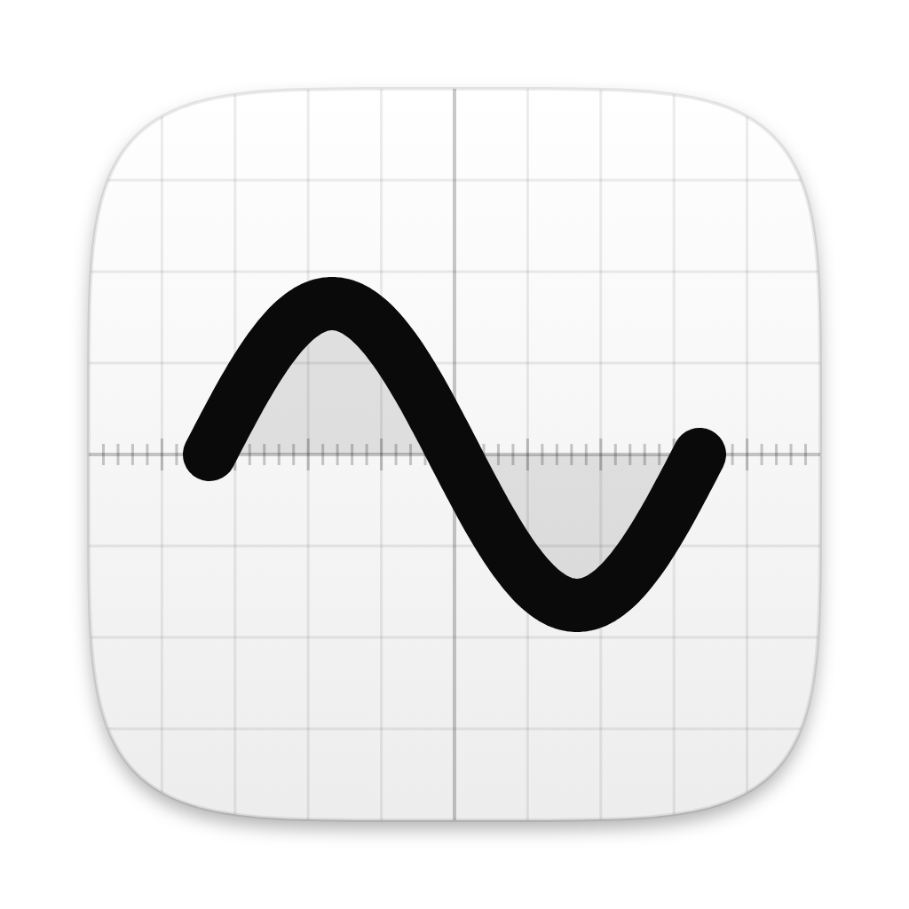
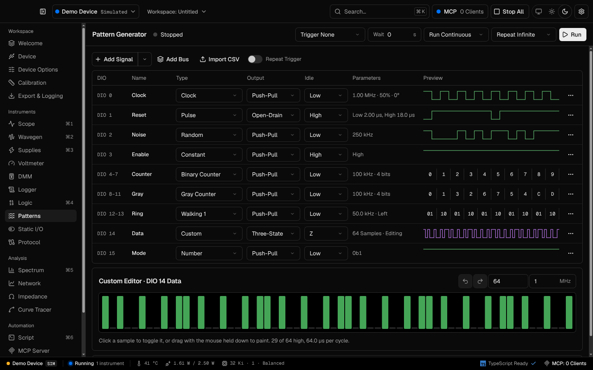

<p align="center"></p>

<h1 align="center">Oscillo</h1>

<p align="center">A test and measurement app for Digilent instruments on macOS.</p>

<picture>
  <source media="(prefers-color-scheme: light)" srcset="docs/images/patterns-light.png">
  
</picture>

## Features

**Instruments.** Oscilloscope, waveform generator, power supplies, voltmeter, multimeter and data logger for the analog side; logic analyzer, pattern generator and static I/O for the 16 DIO pins.

**Protocols.** Talk UART, SPI, I²C, CAN, CEC, JTAG, SWD and AVR from the Protocol page. The logic analyzer decodes UART, SPI, I²C, I²S and CAN on the captured trace.

**Analysis.** Spectrum analyzer, network analyzer (Bode plots), impedance analyzer and curve tracer.

**Pattern generator.** Clocks, pulses, random data, binary and Gray counters, walking ones, constants and hand-drawn custom patterns, each with its own output mode and idle level, previewed live.

**Scripting.** Automate any instrument in TypeScript, in the app or from the command line with `--script`.

**MCP server.** Expose the instruments to Claude, Codex, ChatGPT and other MCP clients. Agents can capture, measure, decode and drive outputs, within voltage limits you set, and Oscillo can ask before each change.

**Workspaces.** Save every instrument's settings to a `.oscillo` workspace, export captures and log to disk. Calibration is kept per device.

**Demo Device.** No hardware? Pick the Demo Device, a simulated Analog Discovery 3 with a small test board on its pins.

**Keyboard first.** <kbd>⌘K</kbd> reaches every page and action, and <kbd>⌘1</kbd>–<kbd>⌘6</kbd> jump to the main instruments. Light and dark themes, or follow macOS.

## Install

Download the `.dmg` from [Releases](https://github.com/robcholz/Oscillo/releases) and drag Oscillo to Applications. Builds are for Apple Silicon and include the WaveForms SDK, so you don't need WaveForms installed.

Oscillo isn't signed or notarized yet, so macOS quarantines it and may say it is damaged or can't be opened. Clear the quarantine flag once after installing:

```sh
xattr -dr com.apple.quarantine /Applications/Oscillo.app
```

## Develop

The design system comes from [robcholz/Geist](https://github.com/robcholz/Geist), vendored in `geist/`.

```sh
git clone https://github.com/robcholz/Oscillo.git
cd Oscillo
npm install
npm run dev          # run the app with hot reload
npm run typecheck
npm test
npm run dist:mac     # .dmg in dist/
```

`npm run screenshot` builds the app and saves a screenshot of every page to `screenshots/` (Linux needs `xvfb-run`; set `THEME=light` for the light theme).

## Layout

| Path | What |
| --- | --- |
| `src/main` | Electron main process: the window, menus, device access (`hardware.ts`), scripting and the MCP server |
| `src/preload` | The `window.oscillo` bridge |
| `src/renderer/src/shell` | Title bar, sidebar, status bar, ⌘K search, shortcuts |
| `src/renderer/src/views` | One file per page |
| `src/renderer/src/components` | App pieces built from Geist: the plot, page layout, settings panel, unit inputs |
| `src/shared/dsp` | Analysis shared by both processes: FFT, spectrum metrics, scope measurements, logic decoders |
| `libs/dwf` | Typed WaveForms SDK bindings, the instrument wrappers and the simulated device |

Components that aren't specific to Oscillo go into Geist, not here.
